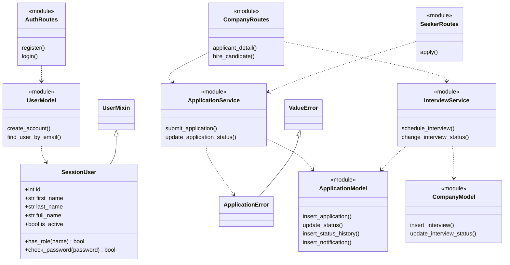

# UML Class Diagram

`SessionUser` is the class used for signed-in users. The boxes marked `module` show the Python modules and functions involved in sign-in and applications. Database entities and cardinalities are shown in the [ER diagram](ER_DIAGRAM.md).

