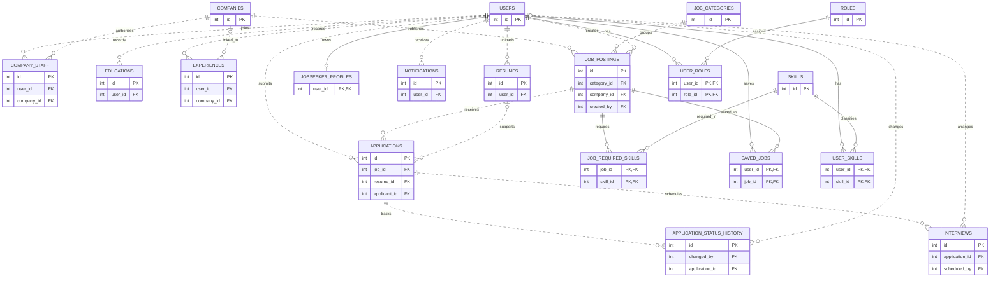

# Entity–Relationship Diagram

The diagram covers the 19 application tables and their 26 foreign-key relationships. A solid line marks a relationship whose foreign key is part of the child table's primary key. A dashed line marks the other foreign-key relationships.

